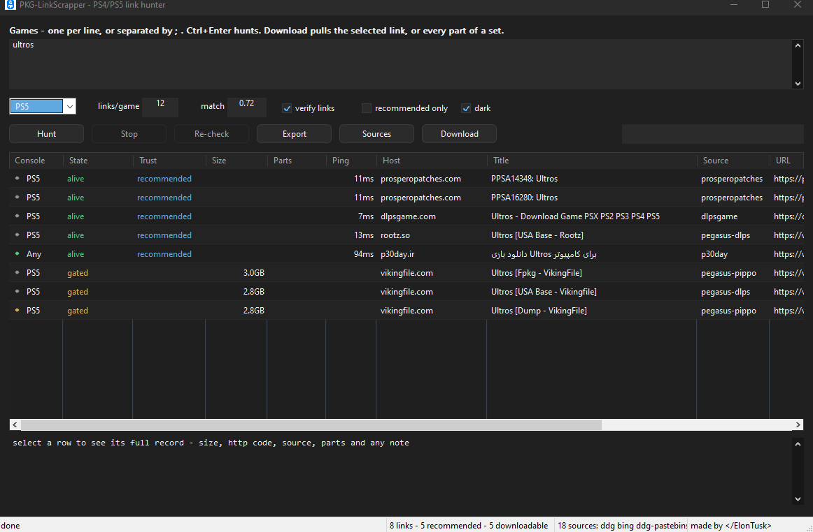

<p align="center">
  
</p>

# PKG-LinkScrapper

Finds PS4 and PS5 game download links and checks whether they actually work.

Type a game name. It searches the known release sites and link catalogs, pulls
the file links those pages carry, probes every one of them, and puts the result
in one list: alive, dead, size, host, where it came from.

<p align="center">
  
</p>

**Download:** [PKG-LinkScrapper.exe](https://github.com/ElnTsk/PKG-LinkScrapper/releases/tag/v1.0-beta)
— one file, no installer, no runtime. Double-click it. **v1.0 beta** — the
report button is there for the misses.

Made by [**&lt;/ElonTusk&gt;**](https://github.com/ElnTsk).

---

## Get started

1. Double-click `PKG-LinkScrapper.exe`.
2. Type a game name in the big box — one per line, or several on one line
   separated by `;`.
3. Pick `PS4` or `PS5` (or leave it on `Both`) and press **Hunt** (or Ctrl+Enter).

Rows appear as they are found and update in place while each link is probed.
A one-game hunt usually takes 30–90 seconds.

## The window

| control | what it does |
| --- | --- |
| Games box | one title per line; `#` starts a comment line |
| Ctrl+Enter | start hunting |
| console dropdown | `Both`, `PS4`, `PS5` |
| `links/game` | how many rows to keep per game (a part set counts as one row) |
| `match` | name strictness, 0.5 loose → 1.0 exact |
| verify links | probe every link for liveness and file size |
| recommended only | hide anything not from a trusted source/host or already proven alive |
| dark | dark window; remembered between runs |
| Hunt / Stop | start a run / cancel it (partial downloads keep what they got) |
| Re-check | probe the rows that are still `unverified`, without searching again |
| Download | fetch the selected link, or every part of the selected set |
| Export | save the visible rows; `.tsv`, `.csv` or `.json` by file extension |
| Sources | list every source, the urls it crawls, park/restore them |
| filter box | live filter across all columns |

Click a column header to sort, again to reverse. Double-click a row to open the
link. Right-click for Open / Copy URL / Copy row, plus Open all parts / Copy all
part URLs on a set.

### Reporting a dead link

Right-click any row → **Report dead link**. The tool sends one report to the
project's log (Discord) with the game, host, source and url, and tags the
maintainer. Each report gets a ✅ / ❌ after a look: approved links are written to
[deadlinks.txt](https://github.com/ElnTsk/PKG-LinkScrapper/blob/main/deadlinks.txt),
and the tool reads that file on the next hunt and stops offering them; rejected
reports are dropped. One report per link — the menu says "already reported"
after the first.

## Reading the list

| state | meaning |
| --- | --- |
| `alive` | the host answered and the file is there |
| `gated` | real page with the right file, but the download needs a captcha or a form — open it in your browser |
| `container` | a filecrypt-style page that reveals the files after its own captcha |
| `shell` | the host served its generic front page; the file cannot be confirmed |
| `stub` | the url names a file but the host answered with an error page |
| `dead` | 404 / 410 — gone |
| `blocked` | 401 / 403 / 451 — the host refuses bots or your region |
| `rate-limited` | 429 — slow down and retry later |
| `partial` | a part set with no live member left |
| `unreachable` | no response at all, and a TCP ping failed too |
| `page` | a release page kept because it exposed no direct link |

Colours: green `alive`, amber `stub`/`partial`/`gated`, red
`dead`/`unreachable`/`failed`, violet `blocked`, grey pages and unverified rows.

`recommended` in the Trust column means the link comes from a trusted host or
source, or an earlier probe already saw it serve bytes. Recommended rows sort
first.

## Part sets

Sites split big games into numbered parts (`part01.rar`, `_0.pkg`, `_1.pkg`).
When the file names carry a part number, the parts become one row with a count
instead of twenty loose rows. Click that row's Parts cell (or press `Right`) to
fold its members open underneath, `Left` to fold them back.

**Download** on a set row pulls every part, in order, into the same folder.

## Downloading

Press **Download** and pick a folder first — the picker opens before anything
starts. The download window then shows each file, MB/s, total progress, and
Cancel. Interrupted downloads resume: pressing Download again continues from
the `.part` file instead of starting over.

What it will not do:

- **captcha hosts** — vikingfile, gofile, rootz, akirabox, datavaults, terabox
  and friends ask a browser for a click or a challenge. Those rows say `gated`,
  and Download refuses before queueing anything: the status bar names the host
  and tells you to open the row. No failed download rows for those.
- **filecrypt containers** — the page holds the real links behind a captcha;
  open it, solve it, copy what it shows.
- **gofile** — javascript builds the file list after the page loads, so nothing
  in the response can confirm a link. `shell` means "the page is up, the file is
  unproven".

One exception is walked in-app: **1fichier** share links are resolved to their
real mirror on click (the poster form is posted, the mirror link extracted).
1fichier gives free users one download slot — if a queue message comes back, the
details pane says so and asks for a few minutes.

## Finding the right game

The matcher is deliberately tolerant with spelling and strict about words:

- `Astrobot` finds **Astro Bot**, `spiderman 2` finds **Spider-Man 2**,
  `gtav` finds **GTA V** — a space between words is not a different game
- `god of war ragnarok` will not return *God of War III*, and a PS4 hunt will not
  return PS5 links
- other platforms (PS2/PS3/PSP/Xbox/Switch) are filtered out automatically

If a hunt is too noisy, raise `match` a notch. If it finds nothing, lower it or
drop edition words (`deluxe edition`, `remastered`…).

## Sources window

**Sources** lists every source the tool knows, the urls it crawls, and how many
rows it contributed to the current hunt.

| button | what it does |
| --- | --- |
| Park / restore | take the selected source out of hunts, or put it back; remembered |
| Copy all links | every source and url on the clipboard |
| Write config | save the current list to `%APPDATA%\PKG-LinkScrapper\sources.json` |
| Open folder | open the data folder in Explorer |
| Reload | re-read config and re-count rows |
| Restore shipped | back to the built-in list, everything re-enabled |

## Sources that ship

| source | kind | gives |
| --- | --- | --- |
| `ddg`, `bing` | search | general web search for pkg links |
| `ddg-pastebins` | search | rentry / pastebin / controlc lists |
| `dlpsgame` | site | release pages, hashed links decoded |
| `superpsx` | site | release pages plus their hidden link pages |
| `psxhax`, `pkg-zone` | site | tag and category browsing |
| `p30day`, `p30day-telegram` | site | PSN part links and part sets |
| `archive-org` | site | archive.org search |
| `archive-collections` | site | seven public PS4 fpkg collection folders |
| `pegasus-dlps` | catalog | 1710 PS5 titles, ~31k mirror links (akirabox, vikingfile, rootz, 1fichier…) |
| `pegasus-pippo` | catalog | ~920 PS5 exFAT dumps and fpkg builds |
| `pegasus-pfs` | catalog | ~890 PS5 builds, part numbers in the names |
| `pegasus-zer0` | catalog | ~57 zer0game PS5 releases |
| `github-ps4db` | catalog | 6443 PS4 titles, ~40k links (1fichier, filecrypt, mediafire) |
| `pegasus-ps4` | catalog | 866 PS4 fpkgs on archive.org |
| `prosperopatches` | site | PS5 update tracker — patch versions, sizes, firmware |

Two more ship parked, with the reason written next to them in the config:
`psxhax-forum` (search needs a session cookie) and `arabicps4games` (its links
are captcha lockers).

Catalogs are plain JSON files refreshed by their maintainers. Each one is
downloaded once per program run and kept in memory — restart the app to pick up
its newest version.

**About `pegasus-ps4`:** those archive.org files are real, but most of that
collection is access-restricted — downloading needs a logged-in archive.org
account. Public items verify `alive`; restricted ones verify `blocked` with the
true file size. No login is wired in.

## Adding your own sources

Everything the tool reads is JSON. Put a file at
`%APPDATA%\PKG-LinkScrapper\sources.json` (or any path with `--config`):

```json
{
  "sources": [
    { "name": "my-list", "type": "index",
      "urls": ["https://rentry.co/abc123"], "depth": 1 },

    { "name": "my-search", "type": "search", "engine": "bing",
      "query": "\"{q}\" {console} pkg", "pages": 1, "depth": 1 },

    { "name": "my-catalog", "type": "catalog", "console": "PS5",
      "urls": ["https://example.com/catalog.json"] }
  ]
}
```

- `{q}` is the url-encoded game name, `{q_raw}` the plain one, `{console}` is
  `PS4`/`PS5`.
- `index` fetches `urls` and/or `search_url`; `paged_url` adds pagination.
- `search` runs `query` through `duckduckgo`, `bing` or `searx`.
- `catalog` reads a JSON document of entries with links (see below).
- `depth` 0 = listing only, 1 = follow matching result pages, 2 = one hop deeper.
- `"enabled": false` parks a source; saving a source with a built-in's name
  replaces it.

Config layers merge in this order, later wins by name: built-in defaults →
`<exe dir>\config\` → `%APPDATA%\PKG-LinkScrapper\` → `--config`.
A source the file does not mention keeps its built-in definition.

A catalog entry looks like either of these — both are read:

```json
{"packages": [{"title": "Ultros", "titleId": "PPSA16280",
  "downloadLinks": [{"name": "USA Base - Akirabox", "url": "https://…"}]}]}
```

```json
[{"name": "#KILLALLZOMBIES",
  "download_links": {"mediafire": ["https://…"], "1file": ["https://…"]}}]
```

## Command line

`PKG-LinkScrapper-cli.exe` is the same engine with a console front end, for
scripts and scheduled jobs. (The windowed exe takes game names as arguments but
not the flags.)

```
PKG-LinkScrapper-cli.exe "elden ring" "god of war ragnarok" --console ps4
PKG-LinkScrapper-cli.exe -i games.txt --console both --format json -o found.json
type games.txt | PKG-LinkScrapper-cli.exe --stdin --console ps5
PKG-LinkScrapper-cli.exe --sources
```

| flag | meaning |
| --- | --- |
| `--console ps4\|ps5\|both` | console filter (default both) |
| `--threshold <0..1>` | name strictness (default 0.72) |
| `--limit <n>` | rows per game (default 40) |
| `--max-fetch <n>` | pages crawled per game (default 32) |
| `--no-verify` | skip probing, list candidates only |
| `--refresh` | re-probe even links already known alive |
| `--trusted-only` | recommended rows only |
| `--resolve <url>` | walk one 1fichier share to its mirror (spends the one-time link) |
| `--format table\|json\|csv\|tsv`, `-o <file>` | output shape and destination |
| `--timeout <ms>`, `--concurrency <n>` | network knobs (15000 / 10) |
| `--config <file\|dir>` | extra config layer |
| `--sources` | list loaded sources with their origin files |
| `--clear-dead` / `--forget-good` | reset what the tool remembers |
| `-v`, `--verbose` | per-source detail on stderr |

## Where your data lives

`%APPDATA%\PKG-LinkScrapper\` — nothing is written next to the exe.

| file | what |
| --- | --- |
| `dead.tsv` | links that answered dead/blocked, skipped on later hunts |
| `good.tsv` | links proven alive, with size and date |
| `theme.txt` | dark or light |
| `downloads.txt` | last download folder |
| `sources.json` | written when you park a source or press Write config |

## Questions

**Second hunt for the same game shows fewer rows.**
The dead list grew — those links answered 404/410 and are skipped now. Reset
with `--clear-dead` (CLI) or delete `dead.tsv`.

**A well-known game returns nothing.**
Try the exact release spelling, lower `match` to ~0.6, and check whether the
game is PS5-only while you hunt PS4. Some games genuinely have no working links
anywhere the tool looks; it will list the release page instead of inventing one.

**Why does `gated` exist instead of just "alive"?**
Because the file is there but the host will not hand it to a program — only to a
browser with a click. Marking it alive would be lying about what Download can
do.

**Ctrl+Enter does nothing.**
Click inside the games box first. The window must have focus.

**Dark mode leaves the scrollbar / right-click menu light.**
Windows 10 paints those from the system theme; no per-app fix exists. Windows 11
themes them properly.

## Building from source

Linux (what the release is built with — zig cross-compiles to Windows, no
MinGW install needed):

```bash
./build.sh        # runs the selftest, then builds the exe and the cli
```

Any C++20 compiler with the same flags works — the windowed exe is every source
file except `main.cpp` (that one is the console front end):

```bash
c++ -std=c++20 -O2 src/util.cpp src/json.cpp src/hosts.cpp src/html.cpp \
    src/match.cpp src/config.cpp src/http.cpp src/crawl.cpp src/verify.cpp \
    src/parts.cpp src/trust.cpp src/ping.cpp src/output.cpp src/deadstore.cpp \
    src/download.cpp src/resolve.cpp src/catalog.cpp src/gui.cpp \
    -lwinhttp -lcomctl32 -lcomdlg32 -lshell32 -lole32 -luuid -lgdi32 \
    -luser32 -ldwmapi -luxtheme -ladvapi32 -lws2_32 -mwindows \
    -o PKG-LinkScrapper.exe
```

Tests: `build/selftest` — 174 checks over parsing, matching, host
classification, part grouping and catalog reading.

## How it works, briefly

Sources emit candidate urls. A site source is crawled (search pages, release
pages, hidden link blocks, pagination); a catalog source is parsed as JSON and
matched by title and titleId. Every candidate is classified by host — file
hosts, containers, shorteners, direct `.pkg` files — the page is read when the
host is known to serve HTML, and the link is probed with a ranged request to get
status and size. Part numbers in file names are grouped into sets. Everything
alive is remembered, everything dead is skipped next time.

---

made by </ElonTusk> · [github.com/ElnTsk](https://github.com/ElnTsk)
